# 🌤️ 창원 날씨 AI

창원시 2000년부터 쌓인 월별 기온 데이터를 바탕으로 질문에 답해 주는 **AI 날씨 비서**입니다.

- 🌐 서비스 주소: https://changwon-weather-ai-frontend.vercel.app
- ⚙️ API 서버: https://changwon-weather-ai.onrender.com
- ❤️ 상태 확인: https://changwon-weather-ai.onrender.com/health
- 📄 API 문서: https://changwon-weather-ai.onrender.com/docs

> 무료 서버를 사용해서, 한동안 접속이 없으면 첫 응답까지 30초~1분 정도 걸릴 수 있습니다. ([대응 방안](#-무료-서버-슬립콜드-스타트-대응))

---

## 📌 프로젝트 소개

"2023년 8월은 몇 도였어?", "가장 추웠던 달은 언제야?"처럼 자연어로 물으면
AI가 Firestore에 저장된 **322개월(2000-01 ~ 2026-10) 기온 데이터**를 근거로 답합니다.
나눈 대화는 자동으로 저장되어 언제든 다시 볼 수 있습니다.

## ✨ 주요 기능

| 기능 | 설명 |
|---|---|
| 데이터 요약 | 전체 기간, 데이터 개수, 평균·최고·최저 기온, 기온 추세 표시 |
| AI 날씨 비서 | 월별 데이터를 바탕으로 연도·월·계절별 질문에 답변 |
| 대화 기록 | 질문과 답변을 Firestore에 자동 저장, 대화방별로 다시 보기 |
| 데이터 관리 | 월별 기온 데이터 조회·추가·수정·삭제 (CRUD) |

## 🛠️ 기술 스택

| 구분 | 사용 기술 |
|---|---|
| 백엔드 | Python 3.11, FastAPI, Uvicorn |
| 데이터베이스 | Firebase Firestore |
| AI | OpenAI SDK + gemini-3-flash |
| 프론트엔드 | HTML, CSS, JavaScript |
| 배포 | Render(백엔드), Vercel(프론트엔드) |
| 버전 관리 | Git, GitHub |

## 📁 폴더 구조

```text
changwon-weather-ai/
├── backend/
│   ├── main.py              # 서버 시작, CORS·Firebase 설정, /health, 라우터 연결(/api/data 포함)
│   ├── requirements.txt     # 필요한 라이브러리 목록
│   └── routes/
│       ├── weather.py       # 월별 기온 CRUD, 데이터 요약
│       ├── chat.py          # AI 질문·답변
│       └── conversations.py # 대화 기록 저장·조회·삭제
├── frontend/
│   ├── index.html
│   └── static/
│       ├── css/style.css
│       └── js/app.js
├── scripts/                 # 데이터 전처리, Firestore 업로드
├── data/                    # 창원 월별 기온 CSV
├── docs/
│   └── screenshots/         # 실행 증거 캡처 (README 하단 "실행 증거" 섹션)
└── README.md
```

## 🔌 주요 API

| 메서드 | 주소 | 설명 |
|---|---|---|
| GET | `/health` | 서버 상태 확인 |
| GET | `/api/data/summary` | 전체 데이터 요약 (PRD 요구 경로) |
| GET | `/api/data/` | 전체 월별 데이터 |
| GET | `/api/data/{year}` | 특정 연도 데이터 |
| GET | `/api/data/{year}/{month}` | 특정 월 데이터 |
| POST | `/api/data/` | 월별 데이터 추가 |
| PUT | `/api/data/{year}/{month}` | 월별 데이터 수정 |
| DELETE | `/api/data/{year}/{month}` | 월별 데이터 삭제 |
| POST | `/chat` | AI에게 질문 |
| GET | `/conversations/` | 전체 대화 기록 |
| POST | `/conversations/` | 대화 저장 |

> 날씨 데이터 API는 PRD 요구 경로인 `/api/data/...`와, 프론트엔드가 사용하는 기존 경로(`/summary`, `/{year}` 등) **두 가지로 모두 접속**할 수 있습니다. 두 경로는 같은 코드(`routes/weather.py`)를 사용하므로 결과가 항상 같습니다.

전체 목록과 직접 테스트는 `/docs`에서 할 수 있습니다.

## 🗄️ 데이터베이스 설계 (Firestore)

데이터의 성격이 서로 달라서 컬렉션을 **2개로 나눴습니다.**

| 컬렉션 | 저장 내용 | 문서 ID | 필드 |
|---|---|---|---|
| `monthly_weather` | 창원 월별 기온 | `YYYY-MM` (예: `2023-08`) | `year`, `month`, `avg_temp`, `max_temp`, `min_temp`, `rainfall` |
| `conversations` | AI와 나눈 대화 | Firestore 자동 ID | `user_message`, `bot_response`, `session_id`, `created_at` |

**나눈 이유**

| 기준 | `monthly_weather` | `conversations` |
|---|---|---|
| 데이터 성격 | 기준 자료 (거의 바뀌지 않음) | 사용 기록 (계속 쌓임) |
| 늘어나는 속도 | 1년에 12개 | 질문할 때마다 1개 |
| 주로 찾는 방식 | 연·월로 바로 찾기 | 최신순 정렬, 대화방(`session_id`)별 묶기 |
| 삭제·관리 | 잘못 입력한 달만 수정 | 대화 기록만 따로 삭제 |

- `monthly_weather`는 문서 ID를 `YYYY-MM`으로 정해서, `2023-08`처럼 **ID 하나로 바로 조회**하고 같은 달이 **중복 저장되지 않게** 했습니다.
- `conversations`는 대화가 계속 늘어나므로 자동 ID를 쓰고, `created_at`(한국 시간, ISO 형식)으로 정렬합니다.
- 한 컬렉션에 섞으면 대화가 쌓일수록 기온 데이터를 읽을 때 불필요한 문서까지 걸러야 하므로 분리했습니다.

## 🧠 AI 컨텍스트 주입 방식

### 작동 방식
질문이 올 때마다 `chat.py`의 `build_system_prompt()`가 아래 내용을 **시스템 프롬프트**에 넣어 AI에게 보냅니다.
1. 데이터 요약 (기간, 개수, 평균·최고·최저, 추세)
2. 월별 데이터 표 322줄 (`2023-08 | 27.7 | 35.8 | 22.2 | ...`)
3. 답변 규칙 (계절 기준, 숫자 근거 제시, 데이터에 없으면 모른다고 답하기)

### 기대 효과
| 장점 | 설명 |
|---|---|
| 정확한 답변 | AI가 기억에 의존하지 않고 실제 데이터의 숫자로 답함 |
| 환각 감소 | "데이터에 없으면 모른다고 답하라" 규칙으로 지어낸 답변 방지 |
| 최신 데이터 반영 | 데이터를 추가·수정하면 다음 질문부터 바로 반영 |
| 단순한 구조 | 별도 검색 시스템(벡터 DB 등) 없이 구현 가능 |

### 개선 과정
처음에는 요약 6줄만 넣어서 "2018년 여름은 얼마나 더웠어?" 같은 질문에 "데이터가 없다"고 답했습니다.
월별 데이터를 함께 넣은 뒤 "2023년 8월 평균기온은 27.7℃" 처럼 구체적인 숫자로 답하게 되었습니다.

### 잠재 리스크와 대응 계획
| 리스크 | 설명 | 대응 계획 |
|---|---|---|
| 비용·속도 | 질문마다 322줄을 보내므로 데이터가 늘수록 토큰 비용과 응답 시간 증가 | 질문에 나온 연도만 골라 넣기 |
| DB 읽기 증가 | 질문마다 Firestore 전체를 읽음 | 요약·월별 데이터를 서버 메모리에 캐시 |
| 길이 한도 | 일별 데이터로 바꾸면 AI가 한 번에 읽을 수 있는 양을 넘을 수 있음 | 필요한 데이터만 조회하는 함수 호출(Function Calling) 방식으로 전환 |
| 잘못 읽기 | 표가 길면 AI가 다른 달 값을 잘못 읽을 가능성 | 답변 규칙에 "연-월과 숫자를 함께 제시"하도록 해 사용자가 확인 가능 |

## 😴 무료 서버 슬립(콜드 스타트) 대응

### 원인
Render 무료 요금제는 **15분 동안 요청이 없으면 서버를 잠재우고**, 다음 요청이 오면 다시 켭니다. 이때 첫 응답이 30초~1분 늦어집니다.

### 현재 적용한 것
- `/health` 엔드포인트: 데이터베이스나 AI를 거치지 않는 가벼운 주소라 서버를 깨우는 용도로 쓸 수 있습니다.
- README 상단에 지연 가능성 안내

### 대응 방안
| 방안 | 방법 | 장단점 |
|---|---|---|
| 주기적 ping | UptimeRobot, cron-job.org 같은 무료 모니터링 서비스로 10~14분마다 `/health` 호출 | 잠들지 않게 유지 / 무료 사용 시간 한도 안에서 운영해야 함 |
| 페이지 접속 시 미리 깨우기 | 프론트엔드가 열리자마자 `/health`를 먼저 호출하고 "서버 준비 중" 안내 표시 | 사용자가 기다리는 이유를 알 수 있음 / 첫 대기 시간 자체는 남음 |
| 시연 전 수동 접속 | 발표·평가 1~2분 전에 사이트를 미리 열어 둠 | 가장 간단 / 사람이 기억해야 함 |
| 유료 요금제 | Render 유료 인스턴스로 변경 | 슬립 없음 / 비용 발생 |

## 💻 내 컴퓨터에서 실행하기

### 1. 준비
```bash
git clone https://github.com/fdyoung9-a11y/changwon-weather-ai.git
cd changwon-weather-ai
python -m venv venv
venv\Scripts\activate
pip install -r backend/requirements.txt
```

### 2. 환경 변수 (`backend/.env`)
```text
OPENAI_API_KEY=발급받은_API_키
OPENAI_API_BASE=https://copa.codyssey.kr/v1
FIREBASE_KEY_PATH=Firebase_서비스_계정_키_파일_경로
```
> `.env`와 Firebase 키 파일은 `.gitignore`로 GitHub에 올라가지 않습니다.

### 3. 실행 (터미널 2개)
```bash
# 터미널 1 - 백엔드
cd backend
uvicorn main:app --reload

# 터미널 2 - 프론트엔드
cd frontend
python -m http.server 5500
```
브라우저에서 http://localhost:5500 접속

## 🚀 배포 구성

| 항목 | Render (백엔드) | Vercel (프론트엔드) |
|---|---|---|
| Root Directory | `backend` | `frontend` |
| 실행 | `uvicorn main:app --host 0.0.0.0 --port $PORT` | 정적 파일 |
| 환경 변수 | `OPENAI_API_KEY`, `OPENAI_API_BASE`, `FIREBASE_SERVICE_ACCOUNT_JSON`, `ALLOWED_ORIGINS`, `PYTHON_VERSION` | 없음 |

- 프론트엔드는 접속 주소를 보고 **로컬이면 `localhost:8000`, 배포 사이트면 Render 서버**를 자동으로 사용합니다.
- 배포 서버에는 키 파일 대신 키 내용 전체를 `FIREBASE_SERVICE_ACCOUNT_JSON` 환경 변수로 넣습니다.
- 비밀값은 코드나 GitHub에 쓰지 않고 **Render 환경 변수 화면에만** 입력합니다.

`ALLOWED_ORIGINS` 예시 (쉼표로 구분, 주소 끝 `/` 없이):
```text
https://changwon-weather-ai-frontend.vercel.app,http://localhost:5500,http://127.0.0.1:5500
```

## 🔧 개발하며 해결한 문제

| 문제 | 원인 | 해결 |
|---|---|---|
| `/health` 접속 시 422 오류 | `/{year}` 주소가 먼저 등록되어 `health`를 연도로 해석 | `/health`를 라우터보다 먼저 등록 |
| 배포 사이트에서 데이터 불러오기 실패 | CORS 허용 목록에 Vercel 주소 없음 | `ALLOWED_ORIGINS`에 Vercel 주소 추가 |
| 대화 시간이 9시간 늦게 표시 | 배포 서버가 UTC 기준 시간 사용 | 저장 시 한국 시간(KST)으로 기록 |
| AI가 특정 연도·월 질문에 답하지 못함 | AI에게 요약 정보만 전달 | 322개월 월별 데이터를 함께 전달 |
| 요약 API 경로가 PRD와 다름 | 기존 경로 `/summary` 사용 | `/api/data` 경로를 추가로 연결 |

## 🧪 실행 증거 (배포 환경에서 직접 확인한 결과)

아래는 모두 2026-10-29 배포된 서비스에 실제로 접속해 확인한 화면입니다.

### 1. 배포 접속 확인

**프론트엔드** (https://changwon-weather-ai-frontend.vercel.app)

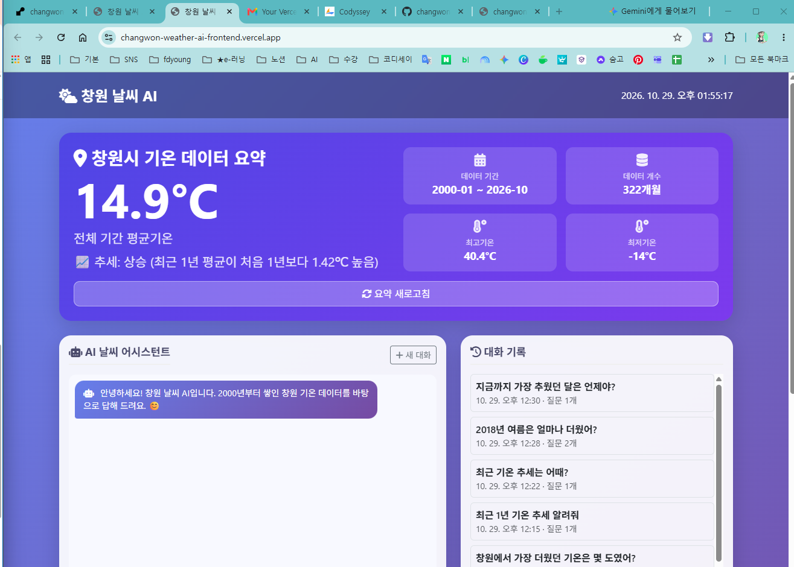

**백엔드 서버 상태** (`GET https://changwon-weather-ai.onrender.com/health`)

```json
{"status":"ok"}
```

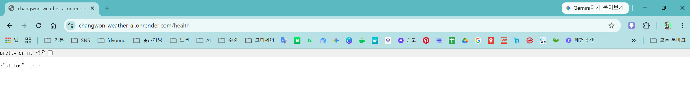

### 2. API 문서 (Swagger UI)

`https://changwon-weather-ai.onrender.com/docs` 접속 화면입니다. 데이터 조회·추가·수정·삭제, AI 채팅, 대화 저장·조회 API가 목록으로 확인됩니다.

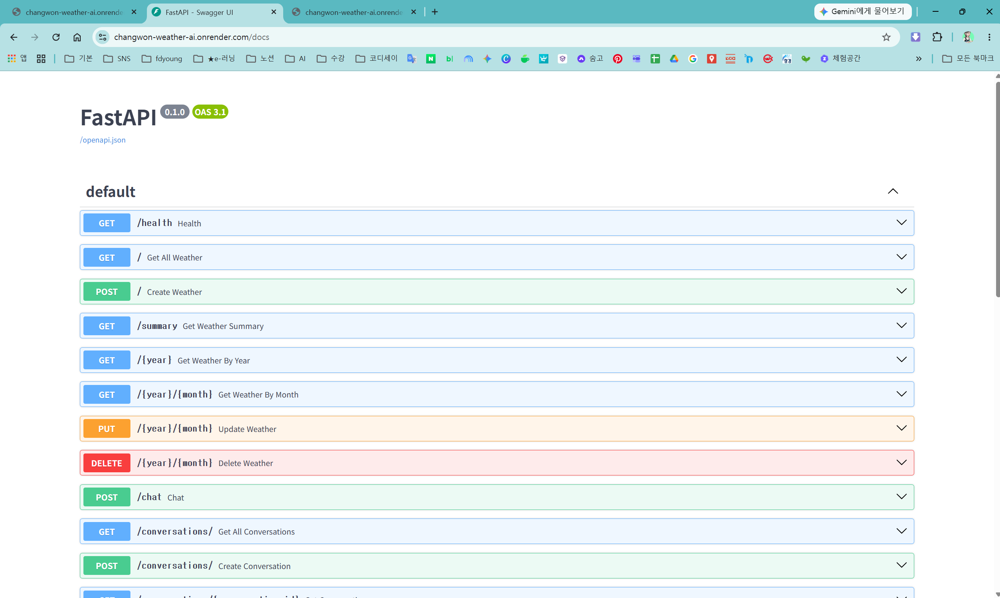

### 3. 데이터 추가 → Firestore 반영 → 삭제

테스트용으로 2026년 11월 데이터를 추가한 뒤, 다시 삭제해 원래 상태로 되돌렸습니다.

| 단계 | 확인 내용 |
|---|---|
| 추가 | 데이터 관리 표 맨 위에 `2026-11` 행이 생김 |
| 반영 | 요약 카드가 322개월 → **323개월**, 기간이 `~ 2026-11`로 바뀜 |
| 삭제 | "2026년 11월 데이터를 삭제했어요." 메시지, 표 맨 위가 `2026-10`으로 돌아옴 |
| 복구 | 요약 카드가 다시 **322개월**, `~ 2026-10`으로 돌아옴 |

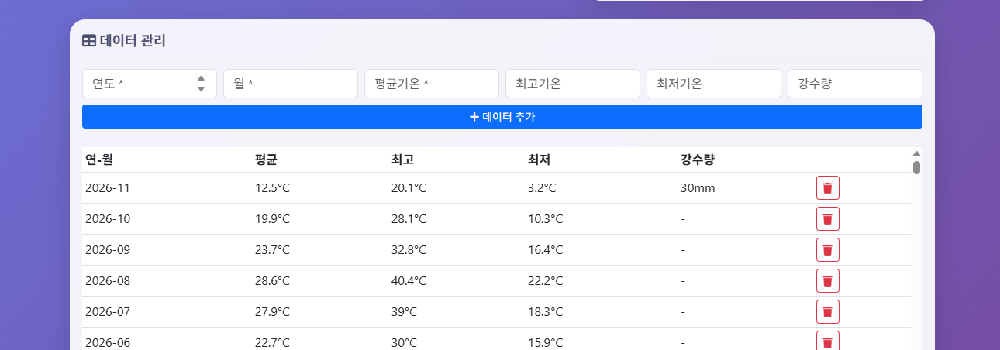
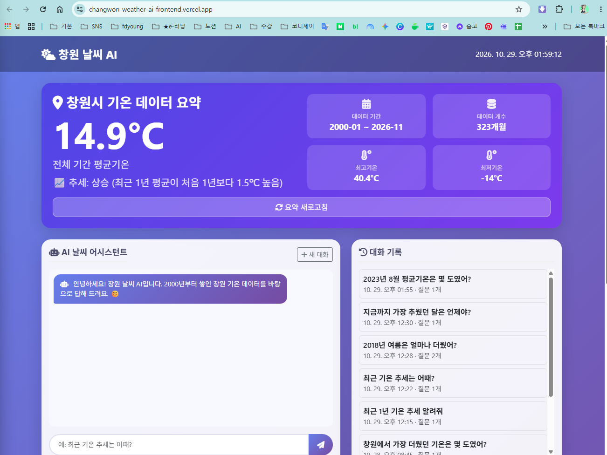
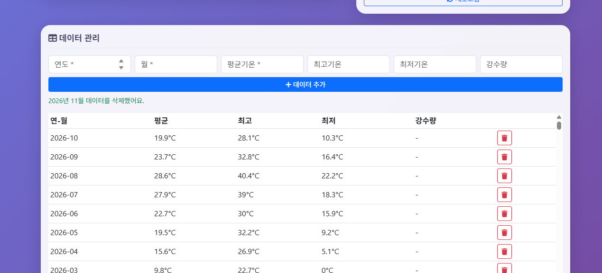
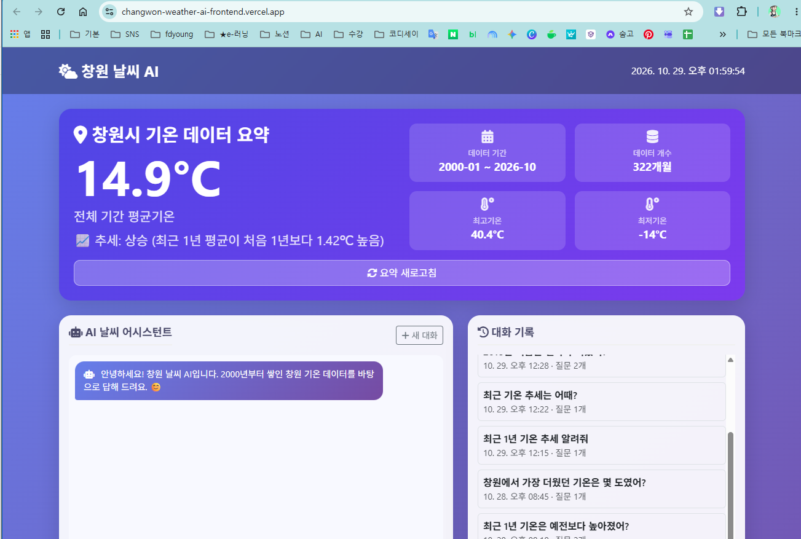

### 4. AI 채팅

질문: "2023년 8월 평균기온은 몇 도였어?"
답변: 2023년 8월 창원 평균기온 27.7℃, 최고 35.8℃, 최저 22.2℃

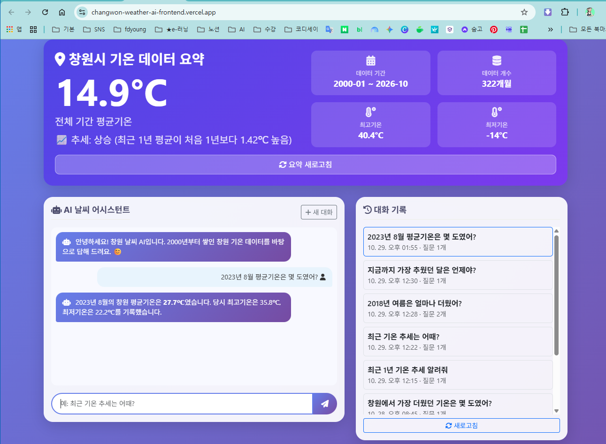

### 5. 대화 저장 및 불러오기

**저장된 대화 조회** (`GET https://changwon-weather-ai.onrender.com/conversations/`) 응답 일부:

```json
{
  "count": 10,
  "data": [
    {
      "session_id": "a9e0e874-97ee-4daa-843e-12ebbfe5466a",
      "user_message": "2023년 8월 평균기온은 몇 도였어?",
      "bot_response": "2023년 8월의 창원 평균기온은 **27.7℃**였습니다. 당시 최고기온은 35.8℃, 최저기온은 22.2℃를 기록했습니다.",
      "created_at": "2026-10-29T13:55:49.493565+09:00",
      "id": "jrctnprSmkJNEzVmSPqs"
    }
  ]
}
```

채팅으로 보낸 질문이 Firestore `conversations` 컬렉션에 저장되고, 위 API로 다시 조회되는 것을 확인했습니다.

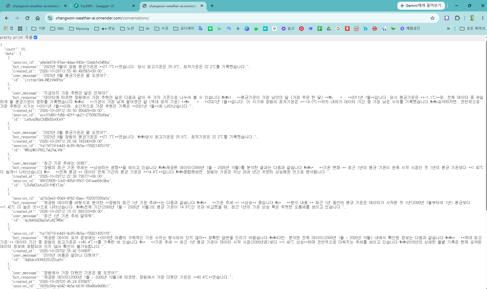

**화면에서 불러오기**: "새 대화"로 채팅창을 비운 뒤 오른쪽 대화 기록을 클릭하면, 저장된 대화가 다시 나타납니다.

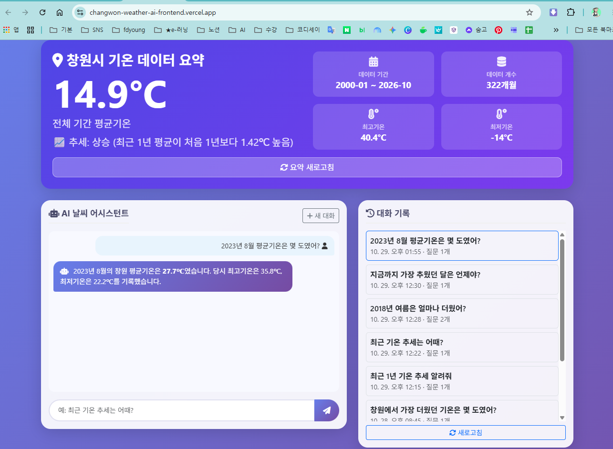

### 6. 모바일 화면

크롬 개발자 도구(iPhone 16 Pro Max)로 확인한 화면입니다. 요약 카드와 채팅창이 위아래로 쌓여 보이고, Network 탭에서 `summary`, `conversations/` 요청이 모두 200(성공)입니다.

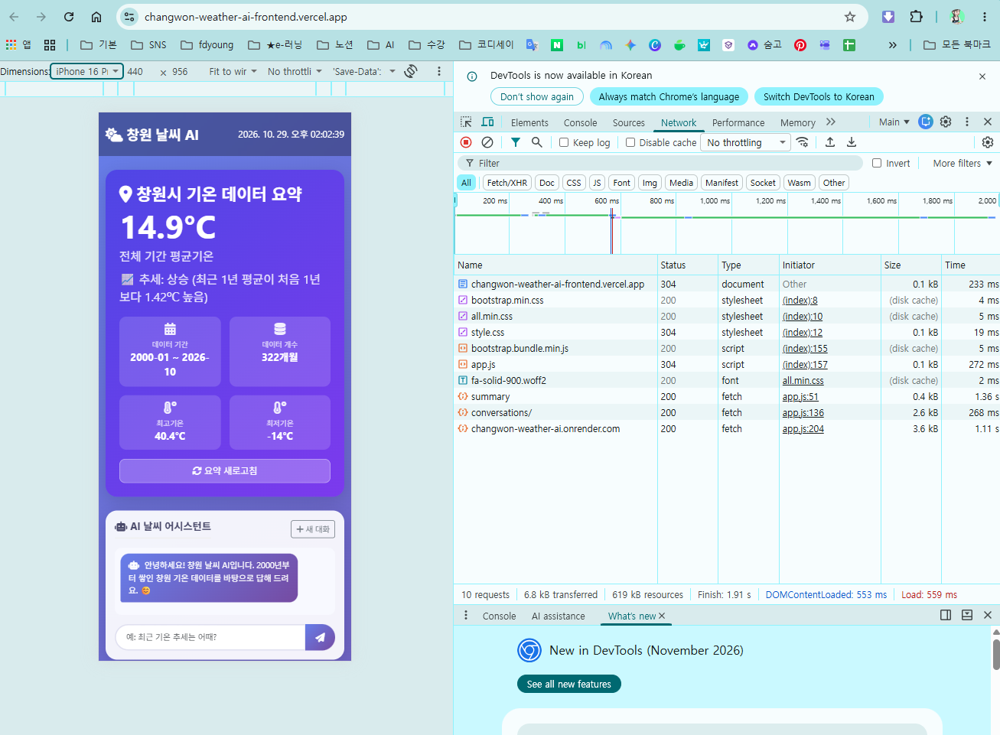
